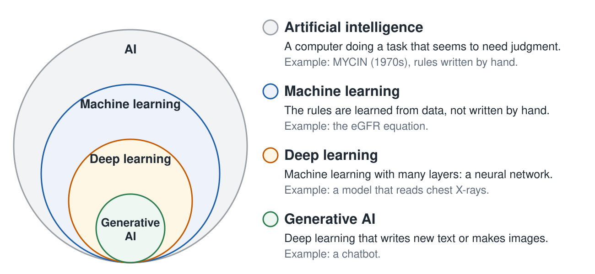
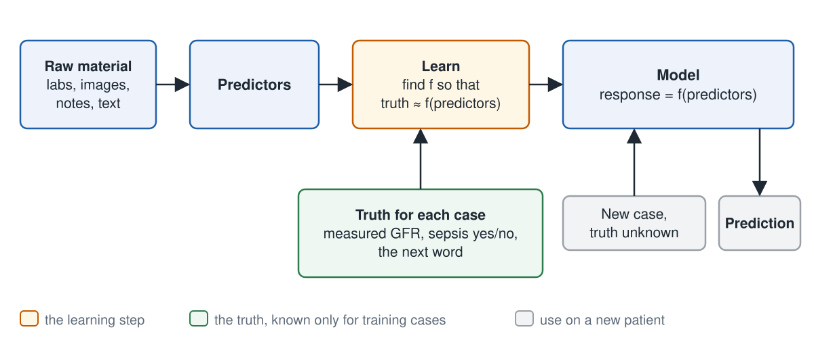
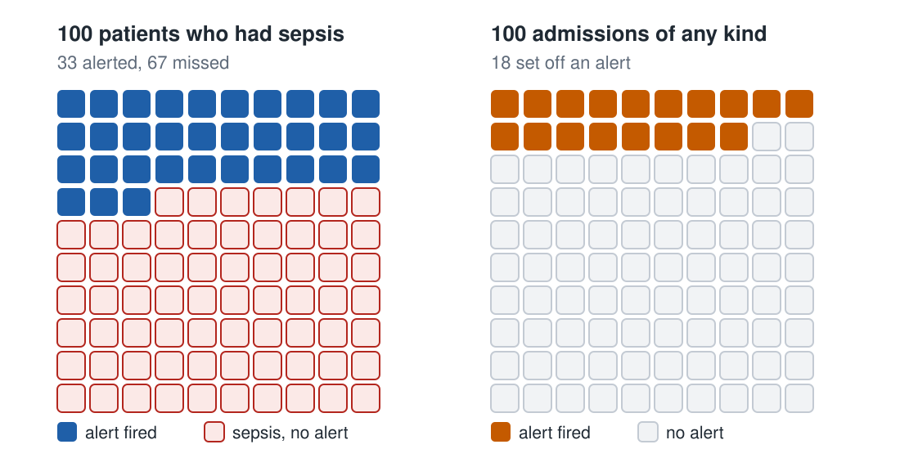
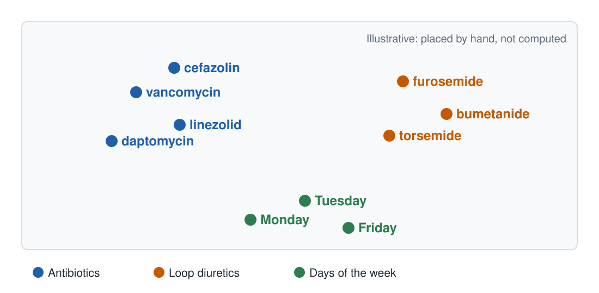
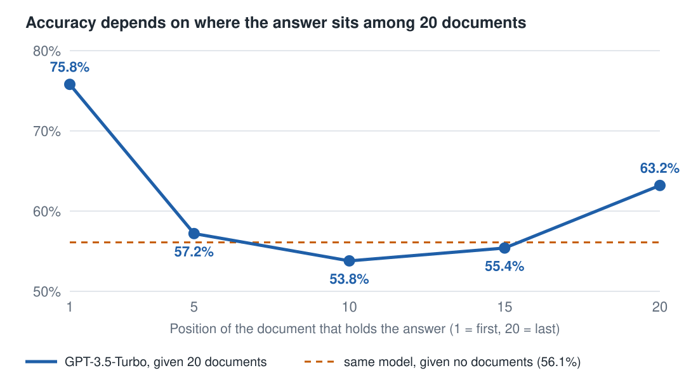

## Three rules for every session {.center-v}

1. **No patient information** in any chatbot, including your school's, unless your hospital's privacy office has approved that tool in writing.
2. **Check it before it counts.** A claim you have not checked is not a fact yet.
3. **You sign the note.** Whatever helped write it, you are responsible for it.

Rule 2 follows from how these systems are built, and today you will see why. Rule 1 follows from who receives what you type.

::: notes
Welcome. This session takes about sixty minutes live, or about seventy on your own with the pauses. You will try several things in a browser as we go, and nothing needs installing.

Three rules apply in every session of this course. No patient information goes into any chatbot, including the one your school gives you, unless your hospital's privacy office has approved that tool in writing. A claim you have not checked is not a fact yet. And you sign the note, whatever helped you write it.

The second rule follows from how these systems are built, and by the end of today you should be able to say why in one sentence. The first rule follows from something simpler: whoever runs the tool receives what you type.

LIVE: Run sheet, with minutes per block, for about 57 minutes of talk and 3 for questions. Before class: create the slide 7 question as an anonymous Zoom poll. 0 to 5 (5 min): slides 1 to 4. 5 to 14 (9 min): slides 5 to 10, with the poll on slide 7; on slide 10, move the two sliders yourself for about two minutes, then press "Show the best fit". 14 to 31 (17 min): slides 11 to 22; slide 17 ninety seconds; slide 19 two minutes; slide 20 one minute; slide 21 one minute, as a callback to Tuesday's talk. 31 to 48 (17 min): slides 23 to 35; skip 26 and 28; give slide 29 one sentence; demonstrate the tokenizer, the sampler and the window sliders yourself rather than waiting for everyone, about 45 seconds each. 48 to 57 (9 min): slides 36 to 39; read slide 38 in one minute; end on the Thursday line on slide 39. 57 to 60: questions. Slides 40 to 42 are for students afterwards; slide 41 has the further-exploration list, including the TensorFlow Playground exercise.

LIVE: Turn on Zoom live captions and paste the deck link into the chat at the start. Paragraphs in these notes that start with PAUSE are for the recorded version; skip them live. ChatGPT Edu and Microsoft Copilot are this course's institutional tools; swap in your school's. Click outside a slider or text box before using the arrow keys.
:::

## What you will be able to do {.smaller}

:::: {.columns}
::: {.column width="64%"}
::: panel
[By the end of this session you can]{.ptitle}

1. Say how **AI, machine learning, deep learning, and generative AI** fit inside each other.
2. Say what the eGFR was **learned from**: its inputs, its output, the people it was fit to, and what **fitting** it meant.
3. Sort any model with **two questions**.
4. Explain why a model's score on cases it **has already seen** tells you nothing, and what the **three sets** are for.
5. Say in one sentence why a chatbot can give you a **citation that does not exist**.
6. Name two limits of the **context window**, and what each changes about how you type.
:::
:::
::: {.column width="36%"}
::: {.panel .warm}
[The hour]{.ptitle}

| Block | Minutes |
|---|--:|
| Start | 5 |
| The eGFR, and how models learn | 26 |
| From tables to words | 17 |
| Back to the clinic | 9 |
| Questions | 3 |

: {.big tbl-colwidths="[75,25]"}

**You need:** a browser. Nothing to install, and no account. You will try things on the slides as we go.
:::
:::
::::

[Click outside a slider or answer box before using the arrow keys. The narration is also available [as text](core-foundations-narration.txt).]{.src}

::: notes
Here is what you will be able to do by the end. Say how AI, machine learning, deep learning, and generative AI fit inside each other. Say what the eGFR was learned from: its inputs, its output, the people it was fit to, and what fitting it meant. Sort any model with two questions. Explain why a model's score on cases it has already seen tells you nothing, and what the three sets are for. Say in one sentence why a chatbot can give you a citation that does not exist. And name two limits of the context window, and what each one changes about how you type.

The session is a talk in three parts, with short things to try in your browser as we go. First the eGFR, and how any model learns from data. Then the chatbot, which is the same idea with words. Then back to the clinic.

You need only a browser. Nothing needs installing, and you do not need an account.

If you only want what to do on the wards, the practical slides are 21, 37 and 38.
:::

## Four words, each inside the one before

{.card fig-alt="Four nested circles. The largest is artificial intelligence: a computer doing a task that seems to need judgment, such as MYCIN in the 1970s, whose rules were written by hand. Inside it is machine learning: the rules are learned from data, such as the eGFR equation. Inside that is deep learning: machine learning with many layers, a neural network, such as a model that reads chest X-rays. The smallest is generative AI: deep learning that writes new text or makes images, such as a chatbot." height="560"}

Each is one kind of the one around it. Yesterday we saw how we got here. Today: how the models inside these circles are made.

::: notes
Yesterday's talk was the history: how we got from rules written by hand to the chatbots of today. Here are four words from that history, and how they fit together. If you missed yesterday, nothing today depends on it.

Artificial intelligence is the largest circle. It means a computer doing a task that seems to need judgment, by any method. MYCIN, from the 1970s, advised on antibiotics with rules that experts wrote by hand.

Machine learning is inside it. The rules are not written by hand. They are learned from data. The eGFR equation on every chemistry panel is an example. A statistician would call it a regression. The line between statistics and machine learning is blurry, and for this course a model learned from data counts.

Deep learning is inside machine learning. It uses a neural network: many layers of simple units, each passing numbers to the next. Models that read images, such as chest X-rays, are usually built this way.

Generative AI is inside deep learning. These models write new text or make new images. A chatbot is the example you know.

Today we start in the second circle, with the eGFR, and end in the smallest, with the chatbot. The same loop is under both.
:::

## [Part 1]{.year} The number nobody measured {.divider background-color="#173f45"}

::: notes
Now to a clinic, and a model you already use.
:::

## Pre-op clinic, surgery sub-internship {.center-v}

:::: {.columns}
::: {.column width="48%"}
A 62-year-old woman is booked for a laparoscopic cholecystectomy. Her basic metabolic panel is back.

::: fragment
The attending asks: **are her kidneys all right for the contrast CT?**

You say: *"eGFR 57, stage 3a, mildly reduced. Probably fine with hydration."*
:::
:::

::: {.column width="52%"}
::: lab-report
<div class="hdr">Basic metabolic panel · collected 07:12</div>
<table>
<tr><td>Sodium</td><td>139</td><td></td><td>136–145</td></tr>
<tr><td>Potassium</td><td>4.1</td><td></td><td>3.5–5.1</td></tr>
<tr><td>Creatinine</td><td>1.10</td><td></td><td>0.50–1.10</td></tr>
<tr><td>eGFR (CKD-EPI 2021)</td><td>57</td><td class="flag">L</td><td>&gt;60</td></tr>
</table>
<div class="fine">Units: mmol/L; creatinine mg/dL; eGFR mL/min/1.73 m². Illustrative panel, made up for this course. Not a real patient.</div>
:::
:::
::::

::: notes
Pre-operative clinic, on your surgery sub-internship. A sixty-two-year-old woman is being worked up for a laparoscopic cholecystectomy. Her basic metabolic panel is back, and one line is flagged low: an eGFR of fifty-seven, where the lab's reference is above sixty.

The attending asks whether her kidneys are all right for the contrast CT the surgeon wants. You answer the way everyone answers. eGFR fifty-seven, stage three a, mildly reduced, probably fine with hydration. The attending nods, and that is the whole conversation. You will have it several hundred times in intern year.

The panel on the slide is made up for this course. It is not a real patient.
:::

## Where does the 57 come from?

::: panel
```{ojs}
{
  const options = [
    "The analyzer measured it in her blood sample",
    "It was measured from a timed urine collection",
    "An equation calculated it from her creatinine, age, and sex"
  ];
  const form = radioInput(options, "egfr");
  const result = html`<div role="status"></div>`;
  const reveal = html`<button class="w-btn" type="button">Show the answer</button>`;
  reveal.onclick = () => {
    const pick = form.value;
    const answer = "Nobody measured her kidney function. Three numbers went into an equation, and the equation produced 57.";
    result.replaceChildren(pick === 2
      ? html`<div class="fb ok">Right. ${answer}</div>`
      : pick === null
        ? html`<div class="fb">The answer is the equation. ${answer}</div>`
        : html`<div class="fb no">Not this one. No urine was collected, and no blood test measures GFR itself. ${answer}</div>`);
  };
  return html`${form}${reveal}${result}`;
}
```
:::

::: notes
Before I go on, commit to an answer. Where does the fifty-seven come from? Did a machine measure it in her blood? Was it measured from a timed urine collection? Or did an equation calculate it from three other numbers?

PAUSE: 1 min. Pause here, pick one, then press the button.

LIVE: Run this as the anonymous Zoom poll. Show the poll result before you press the button on the slide.
:::

## Nobody measured her GFR {.center-v}

::: incremental
- Measuring GFR means **infusing a marker** the kidney filters and does nothing else with, such as iohexol, and timing how fast it clears.
- That takes hours. It is **rarely done in routine care**.
- The 57 was **computed** from creatinine, age, and sex.
:::

::: {.fragment .statement}
Something turned three numbers into a kidney function.<br>You trusted it enough to clear her for contrast.
:::

::: notes
Nobody measured her glomerular filtration rate. Measuring it means infusing a marker that the kidney filters and does nothing else with, such as iohexol, and timing how fast it clears. That takes hours, and it is rarely done in routine care.

The fifty-seven was computed from three things the lab did have: her creatinine, her age, and her sex. Something turned those three numbers into a kidney function, and you trusted it enough to clear her for contrast.
:::

## Where did the equation come from? {.center-v}

::: {.statement}
Not from physiology.<br>It was **learned from data**.
:::

::: fragment
A few thousand people did have their GFR measured. A computer was given their creatinine, age, and sex, and one instruction: *find the formula that best predicts the measured number.*
:::

::: {.fragment .statement}
The eGFR is a **model**. *Remember her:* 45 kg, and a year of muscle loss.
:::

::: notes
So where did that equation come from? Not from the physiology of nephrons. It was learned from data.

A few thousand people did have their GFR measured. Their creatinine, age, and sex were given to a computer with one instruction: find the formula that best predicts the measured number.

The eGFR is a model. It is the model you already trust most, and you have probably never asked what it was trained on.

Remember this patient. She weighs forty-five kilograms and has lost a good deal of muscle over a year of illness. We will come back to her at the end. Nobody has told her that a model had a part in the fifty-seven.
:::

## Fit the curve yourself

```{ojs}
dialData = {
  let s = 20261014;
  const rand = () => { s = (s + 0x6d2b79f5) | 0; let t = Math.imul(s ^ (s >>> 15), 1 | s);
    t = (t + Math.imul(t ^ (t >>> 7), 61 | t)) ^ t; return ((t ^ (t >>> 14)) >>> 0) / 4294967296; };
  const gauss = () => Math.sqrt(-2 * Math.log(1 - rand())) * Math.cos(2 * Math.PI * rand());
  return Array.from({ length: 40 }, () => { const cr = 0.6 * Math.pow(4 / 0.6, rand()); return { cr, gfr: 80 * Math.pow(cr, -1.1) * Math.exp(0.15 * gauss()) }; });
}
dialCurve = (a, b) => cr => a * Math.pow(cr, -b)
dialMiss = (a, b) => { const f = dialCurve(a, b); return dialData.reduce((t, p) => t + Math.abs(f(p.cr) - p.gfr), 0) / dialData.length; }
// The best fit, found by trying every setting the two sliders allow.
dialBest = {
  let best = { a: 0, b: 0, miss: Infinity };
  for (let a = 30; a <= 150; a++) for (let k = 0; k <= 40; k++) { const b = +(k * 0.05).toFixed(2), miss = dialMiss(a, b); if (miss < best.miss) best = { a, b, miss }; }
  return best;
}
```

:::: {.columns}
::: {.column width="56%"}
<div class="illus-label">Illustrative data, not the CKD-EPI data. A simpler curve than the real eGFR.</div>

```{ojs}
{
  const W = 640, H = 400, l = 64, r = 14, t = 12, b = 54, ymax = 170;
  const X = cr => l + (cr - 0.5) / 3.5 * (W - l - r), Y = g => H - b - Math.min(g, ymax) / ymax * (H - b - t);
  const f = dialCurve(dialA, dialB);
  const grid = Array.from({ length: 141 }, (_, i) => 0.5 + i * 0.025);
  const path = "M" + grid.map(c => `${X(c).toFixed(1)},${Y(f(c)).toFixed(1)}`).join("L");
  return html`<svg class="wchart" viewBox="0 0 ${W} ${H}" role="img" aria-label="Forty made-up people, creatinine against measured GFR, with the curve for a ${dialA} and b ${dialB}. Average miss ${dialMiss(dialA, dialB).toFixed(1)}.">
    ${[0, 40, 80, 120, 160].map(v => `<line x1="${l}" x2="${W - r}" y1="${Y(v)}" y2="${Y(v)}" stroke="${ink.rule}"/><text x="${l - 8}" y="${Y(v) + 6}" fill="${ink.muted}" font-size="17" text-anchor="end">${v}</text>`).join("")}
    ${[1, 2, 3, 4].map(v => `<text x="${X(v)}" y="${H - b + 24}" fill="${ink.muted}" font-size="17" text-anchor="middle">${v}</text>`).join("")}
    ${dialData.map(p => `<line x1="${X(p.cr).toFixed(1)}" x2="${X(p.cr).toFixed(1)}" y1="${Y(p.gfr).toFixed(1)}" y2="${Y(f(p.cr)).toFixed(1)}" stroke="${ink.terracotta}" stroke-width="1.5" opacity=".8"/>`).join("")}
    ${dialData.map(p => `<circle cx="${X(p.cr).toFixed(1)}" cy="${Y(p.gfr).toFixed(1)}" r="5" fill="${ink.ink}"/>`).join("")}
    <path d="${path}" fill="none" stroke="${ink.teal}" stroke-width="4"/>
    <text x="${(l + W - r) / 2}" y="${H - 8}" fill="${ink.inkSoft}" font-size="18" text-anchor="middle">creatinine, mg/dL</text>
    <text x="22" y="${(t + H - b) / 2}" fill="${ink.inkSoft}" font-size="18" text-anchor="middle" transform="rotate(-90 22 ${(t + H - b) / 2})">measured GFR</text>
  </svg>`;
}
```
:::
::: {.column .dials width="44%"}
<p class="eq">GFR = <b>a</b> × creatinine<sup>−<b>b</b></sup></p>

```{ojs}
viewof dialA = rangeInput({ label: "a", min: 30, max: 150, step: 1, value: 50 })
viewof dialB = rangeInput({ label: "b", min: 0, max: 2, step: 0.05, value: 0.3 })
```

[**a**: the GFR when creatinine is 1.0. **b**: how fast GFR falls as creatinine rises.]{.defn}

```{ojs}
{
  const miss = dialMiss(dialA, dialB), best = dialA === dialBest.a && dialB === dialBest.b;
  return html`<div class="readout" role="status"><span class="k test">Average miss: <b class="dial-miss">${miss.toFixed(1)}</b> mL/min/1.73 m²</span></div>
    ${best ? html`<div class="fb ok">The best fit: no setting of a and b misses by less.</div>` : ""}`;
}
```

```{ojs}
{
  const button = html`<button class="w-btn" type="button">Show the best fit</button>`;
  button.onclick = () => {
    for (const [view, v] of [[viewof dialA, dialBest.a], [viewof dialB, dialBest.b]]) {
      const input = view.querySelector("input");
      input.value = v;
      input.dispatchEvent(new Event("input", { bubbles: true }));
    }
  };
  return button;
}
```

::: fragment
**Fitting** means a computer turns these dials until the error is as small as it can get.
:::
:::
::::

[● one made-up person · thin line: how far the curve misses them · thick line: the curve your dials make. Generated in your browser.]{.src}

::: notes
Here is fitting, done by hand. Each dot is one made-up person: creatinine across, measured GFR up. The thick curve is a simple equation with two numbers in it, a and b. Those two numbers are the dials. The number a sets how high the curve sits: it is the GFR the curve gives at a creatinine of one. The number b sets how fast GFR falls as creatinine rises. Each thin line is a miss: how far one person's measured GFR is from the curve. The number beside the sliders is the average miss.

PAUSE: 2 min. Move the two sliders and make the average miss as small as you can. Then press "Show the best fit".

Fitting means a computer turns these dials until the error is as small as it can get. Here the computer tries every setting the sliders allow and keeps the best one. Real fitting uses faster methods, with the same goal. The real eGFR equation has a few more numbers in it, and it was fit to eight thousand two hundred fifty-four people whose GFR was measured, not to forty made-up dots. A chatbot is the same idea with billions of numbers.

The data on this slide are made up, and the curve is simpler than the real equation. Its numbers are not the real eGFR's.

LIVE: About two minutes. Move the sliders yourself and ask the room which way to move b. Then press the button, and show the last line.
:::

## [Part 1, continued]{.year} The loop every model comes from {.divider background-color="#173f45"}

::: notes
The next fifteen minutes give you five words and two questions. They will sort every model you meet in residency.
:::

## What the equation connects

![Redrawn from the description of the CKD-EPI 2021 development [@pmid:34554658].](../images/egfr-bridge.svg){.card fig-alt="Diagram. Age, sex, and creatinine, the three things the lab has, feed an equation learned from 8,254 people whose GFR was measured. The equation outputs the eGFR on your panel, which stands in for measured GFR, rarely done in routine care. A grey box, muscle mass, diet, and drugs that block secretion, changes creatinine without changing GFR." height="540"}

[A **proxy** is a number you use in place of the one you want, because the one you want is hard to get. Here the eGFR, calculated from three lab values, stands in for measured GFR.]{.defn}

::: notes
Here is what the equation connects. On the left is what the lab can measure: creatinine, age, and sex. On the right is what you actually want to know: the measured GFR, which is rarely done in routine care. The equation joins the two, and it was built from eight thousand two hundred fifty-four specific people.

Look at the grey box at the bottom. Muscle mass, diet, and some drugs change creatinine without changing GFR. Anything in that box changes the result, and the equation cannot tell.

A number you use in place of the one you want, because the one you want is hard to get, is called a proxy. Here the eGFR, calculated from three lab values, stands in for the measured GFR. One of this course's recurring lessons is that proxies fail: the stand-in and the real thing can come apart, and they come apart for some patients more than for others.
:::

## Five words for the rest of the course

| Word | Meaning | In the eGFR |
|---|---|---|
| **Predictors** | the inputs | creatinine, age, sex |
| **Response** | what is being predicted | measured GFR |
| **Training set** | the cases used to fit the equation | 8,254 adults in 10 studies, mostly research participants; 31.5% Black |
| **Test set** | cases held back to check it afterwards | 4,050 people in 12 other studies |
| **Model** | the equation once fit | `eGFR = f(creatinine, age, sex)` |

: {.big tbl-colwidths="[18,32,50]"}

[*f* stands for **function**: a rule that turns inputs into an output. **Fit** means a computer tried numbers in the equation until its predictions were as close to the measured values as they could get [@pmid:34554658].]{.defn}

::: notes
The eGFR story contains every word you need for the rest of the course.

Predictors are the inputs: creatinine, age, and sex. The response is the thing being predicted: the measured GFR. The training set is the eight thousand two hundred fifty-four adults whose numbers were used to fit the equation. They came from ten studies and were mostly research participants. About a third were Black. The test set is the four thousand fifty people from twelve other studies that the equation was checked on afterwards, and had never seen. And the model is the equation itself, once it has been fit.

The letter f stands for function, which just means a rule that turns inputs into an output. Fit means that a computer tried numbers in the equation until its predictions were as close to the measured values as they could get. For the eGFR, the model is a handful of numbers. For a chatbot, it is billions. The role is the same.
:::

## One equation, three generations

| Equation | Learned from | Where it failed, and for whom |
|---|---|---|
| MDRD, 1999 | 1,070 patients who already had kidney disease (558 more held back to test it) | Values too low at higher GFR, so healthy people were labelled as diseased [@pmid:10075613; @pmid:19414839] |
| CKD-EPI, 2009 | 8,254 people in 10 studies | Included a race term. Even with it, the equation overestimated measured GFR in Black adults (median 3.7 mL/min/1.73 m²). An overestimate makes kidney disease look milder than it is [@pmid:34554658] |
| CKD-EPI, 2021 | the same 8,254, refit without race | Now a few mL/min too low in Black adults and too high in others. A version that adds cystatin C, a second blood marker that does not depend on muscle, is more accurate [@pmid:34554658; @pmid:34563581] |

: {.big tbl-colwidths="[16,26,58]"}

::: {.fragment .statement}
The training population is part of the model,<br>as much as the equation is.
:::

::: notes
Here is the history of one equation, rebuilt from the numbers in the papers. Read the last column as a pattern, not as nephrology.

MDRD was fit to one thousand and seventy people who already had kidney disease, and tested on five hundred fifty-eight more. In healthy people it gave values that were too low, and healthy people were labelled as diseased. The 2009 equation was more accurate at higher GFR, and it included a term that adjusted the result for Black race. Even with that term, the 2021 study found it overestimated measured GFR in Black adults. An overestimate makes kidney disease look milder than it is. The 2021 refit removed race, and it is still a few points off in both directions. A version that adds cystatin C, a second blood marker that does not depend on muscle, is more accurate.

Every row says the same thing. The model was fit to these people, and here is what happened to people unlike them. The training population is part of the model, as much as the equation is. Why the race term was there, and who was harmed by it, is the subject of the bias and equity session later in the course.

LIVE: If asked why the race term was added: in the 2009 data, Black participants on average had a higher measured GFR at the same creatinine, and the term adjusted for that. The 2021 paper states that race in these equations is a social and not a biologic construct. In 2021 a national task force recommended the refit without race for all US laboratories, and wider use of cystatin C to confirm the estimate. What the term did to Black patients is the bias and equity chapter's subject.
:::

## The loop, drawn once

{.card fig-alt="Diagram. Raw material such as labs, images, notes, or text becomes predictors. The truth for each case, such as measured GFR, sepsis yes or no, or the next word, joins them in a learning step that finds f so that truth is approximately f of predictors. The result is a model. A new case with unknown truth goes through the model to give a prediction." height="520"}

The eGFR, a sepsis alert, and a chatbot all come from this loop. Only the contents of the boxes differ.

::: notes
Every model in this course, from the eGFR to the chatbot, was built by this same loop. Turn the raw material into predictors. Collect the truth for each case. Learn a function that predicts the truth from the predictors. Then apply it to a new case whose truth you do not have.

The eGFR, a sepsis alert in the EHR, and a chatbot differ only in what goes in these boxes. Keep this picture. We will fill it with words in half an hour.
:::

## Two questions sort any model

| Question | If yes | If no |
|---|---|---|
| Does the training data contain the answer? | **Supervised** | **Unsupervised** |
| If supervised: does the model give a category? | **Classification** | **Regression** (a number) |

: {.big tbl-colwidths="[50,25,25]"}

::: fragment
A regression is wrong **by an amount**. A classification is wrong **by a kind**: a miss or a false alarm. A miss costs the patient who was missed. A false alarm costs the staff who answer it, and the patient worked up for nothing.
:::

::: notes
Two questions sort any model in about ten seconds.

First: does the training data contain the answer? For the eGFR, yes. Someone measured every one of those GFRs. That is supervised learning. If there is no answer column, only patterns to find, it is unsupervised learning.

Second, and only for a supervised model: does it give a category or a number? The eGFR gives a number, so it is a regression. A model that says chronic kidney disease yes or no would be a classification. An unsupervised tool that sorts cases into groups is not a classification, because nobody told it what the groups were.

The difference matters for how you judge it. A regression is wrong by an amount. A classification is wrong by a kind, a miss or a false alarm. A miss costs the patient who was missed. A false alarm costs the staff who answer it, and the patient who is worked up for nothing.
:::

## Try it: sort four models

```{ojs}
sorterRows = [
  { model: "The eGFR", answer: "Supervised · regression",
    why: "measured GFR is in the training data; the output is a number." },
  { model: "An EHR sepsis alert", answer: "Supervised · classification",
    why: "each case was labelled sepsis yes or no; the output is yes or no." },
  { model: "Grouping 10,000 tumor profiles, no diagnoses attached", answer: "Unsupervised",
    why: "there is no answer column; the tool finds groups on its own." },
  { model: "A chatbot predicting the next word", answer: "Supervised · classification",
    why: "the next word is already in the text, so nobody labels anything. Many textbooks call this self-supervised. The output is one word from a fixed list." }
]
sortChoices = ["Supervised · regression", "Supervised · classification", "Unsupervised"]
{
  const table = html`<table class="sorter"><thead><tr><th></th>${sortChoices.map(c => html`<th>${c}</th>`)}</tr></thead>
    <tbody>${sorterRows.map((r, i) => html`<tr><td>${r.model}</td>${sortChoices.map((c, j) =>
      html`<td><input type="radio" name="sort${i}" value="${j}" aria-label="${r.model}: ${c}"></td>`)}</tr>`)}</tbody></table>`;
  const result = html`<div role="status"></div>`;
  const check = html`<button class="w-btn" type="button">Check my answers</button>`;
  check.onclick = () => {
    const picks = sorterRows.map((r, i) => sortChoices[(table.querySelector(`input[name=sort${i}]:checked`) || {}).value]);
    result.replaceChildren(html`<div class="fb compact ${picks.every((p, i) => p === sorterRows[i].answer) ? "ok" : "no"}">${sorterRows.map((r, i) =>
      html`<div>${picks[i] === r.answer ? "✓" : "✗"} <b>${r.model}:</b> ${r.answer}, because ${r.why}</div>`)}</div>`);
  };
  return html`${table}${check}${result}`;
}
```

::: notes
Now you try. Sort these four models with the two questions. The eGFR. A sepsis alert in the EHR. A tool that groups ten thousand tumor expression profiles into clusters, with no diagnoses attached. And a chatbot predicting the next word.

PAUSE: 2 min. Pause here, pick an answer for each row, then press check.

The last one is the surprise. A chatbot is trained with an answer for every case, and nobody had to label anything, because the next word is already sitting in the text. Many textbooks call this self-supervised learning, because the labels come from the text itself. That is why these models could be trained on so much of the internet.

LIVE: Give the room ninety seconds. Ask for the chatbot row in the chat, sent on your count, before you press check.
:::

## Cases it has already seen prove nothing {.center-v}

::: {.statement}
Fit a formula to 8,254 people, then report how well it predicts **those same people**, and you have measured how well it *memorized* them.
:::

::: {.fragment .statement}
A **separate test set** is the least you should accept.<br>A number with no test set is not a number yet.
:::

::: fragment
[The usual rule is three sets: a **training set** to fit the model, a **validation set** to choose between models, and a **test set**, used once, at the end.]{.defn}
:::

::: notes
Here is the mistake the eGFR researchers avoided, and the mistake many vendor slides make.

Suppose you fit a formula to eight thousand people, and then you report how well it predicts those same eight thousand people. You have measured how well the formula memorized them, not how well it will work on the next patient. A flexible enough model can fit its training data perfectly and still be useless.

That is why a separate test set is the least you should accept. Fit on one set of cases, and report performance on a different set the model never saw. When someone gives you one number and does not say which set it came from, you do not have a number yet.

The usual rule uses three sets. The training set is used to fit the model. The validation set is used to choose between models, for example between a simpler one and a more flexible one. The test set is kept aside and used once, at the end. If the test set is used to choose, it becomes a second validation set, and its number is optimistic too. The next slide shows why this matters.
:::

## Too simple, too flexible

```{ojs}
viewof degree = rangeInput({ label: "Flexibility of the model", min: 0, max: 11, step: 1, value: 1 })
```

```{ojs}
bvData = {
  let s = 20261003;
  const rand = () => { s = (s + 0x6d2b79f5) | 0; let t = Math.imul(s ^ (s >>> 15), 1 | s);
    t = (t + Math.imul(t ^ (t >>> 7), 61 | t)) ^ t; return ((t ^ (t >>> 14)) >>> 0) / 4294967296; };
  const gauss = () => Math.sqrt(-2 * Math.log(1 - rand())) * Math.cos(2 * Math.PI * rand());
  const truth = x => Math.sin(3 * x);
  const make = n => Array.from({ length: n }, () => { const x = rand() * 2 - 1; return { x, y: truth(x) + 0.3 * gauss() }; });
  return { truth, train: make(12), test: make(60) };
}

// Least squares in a Legendre basis, solved by modified Gram-Schmidt QR.
function basis(x, d) { const p = [1, x]; for (let k = 1; k < d; k++) p.push(((2 * k + 1) * x * p[k] - k * p[k - 1]) / (k + 1)); return p.slice(0, d + 1); }
function fitPoly(pts, d) {
  const m = pts.length, n = d + 1, Q = pts.map(p => basis(p.x, d)), R = Array.from({ length: n }, () => Array(n).fill(0));
  for (let j = 0; j < n; j++) {
    for (let i = 0; i < j; i++) { let dot = 0; for (let r = 0; r < m; r++) dot += Q[r][i] * Q[r][j]; R[i][j] = dot; for (let r = 0; r < m; r++) Q[r][j] -= dot * Q[r][i]; }
    let nrm = 0; for (let r = 0; r < m; r++) nrm += Q[r][j] ** 2; nrm = Math.sqrt(nrm); R[j][j] = nrm; for (let r = 0; r < m; r++) Q[r][j] /= nrm || 1;
  }
  const qtb = Array.from({ length: n }, (_, j) => pts.reduce((a, p, r) => a + Q[r][j] * p.y, 0)), c = Array(n).fill(0);
  for (let i = n - 1; i >= 0; i--) { let v = qtb[i]; for (let k = i + 1; k < n; k++) v -= R[i][k] * c[k]; c[i] = R[i][i] ? v / R[i][i] : 0; }
  return x => basis(x, d).reduce((a, v, k) => a + v * c[k], 0);
}
rmse = (f, pts) => Math.sqrt(pts.reduce((a, p) => a + (f(p.x) - p.y) ** 2, 0) / pts.length)
bvErrors = Array.from({ length: 12 }, (_, d) => { const f = fitPoly(bvData.train, d); return { d, train: rmse(f, bvData.train), test: rmse(f, bvData.test) }; })
bvFit = fitPoly(bvData.train, degree)
```

:::: {.columns}
::: {.column width="56%"}
```{ojs}
{
  const W = 600, H = 340, p = 14;
  const x = v => p + (v + 1) / 2 * (W - 2 * p), y = v => H / 2 - Math.max(-3, Math.min(3, v)) / 2.2 * (H / 2 - p);
  const grid = Array.from({ length: 241 }, (_, i) => -1 + i / 120);
  const path = f => "M" + grid.map(v => `${x(v).toFixed(1)},${y(f(v)).toFixed(1)}`).join("L");
  const now = bvErrors[degree];
  return html`<svg class="wchart" viewBox="0 0 ${W} ${H}" role="img" aria-label="Fitted curve at flexibility ${degree}: training error ${now.train.toFixed(2)}, test error ${now.test.toFixed(2)}.">
    <path d="${path(bvData.truth)}" fill="none" stroke="${ink.muted}" stroke-width="2" stroke-dasharray="6 6"/>
    ${bvData.test.map(d => `<circle cx="${x(d.x).toFixed(1)}" cy="${y(d.y).toFixed(1)}" r="4" fill="none" stroke="${ink.terracotta}" stroke-width="1.8"/>`).join("")}
    ${bvData.train.map(d => `<circle cx="${x(d.x).toFixed(1)}" cy="${y(d.y).toFixed(1)}" r="6.5" fill="${ink.ink}"/>`).join("")}
    <path d="${path(bvFit)}" fill="none" stroke="${ink.teal}" stroke-width="4"/>
  </svg>`;
}
```
:::
::: {.column width="44%"}
```{ojs}
{
  const W = 520, H = 340, l = 54, r = 16, t = 16, b = 46, cap = 1.5;
  const X = d => l + d / 11 * (W - l - r), Y = e => H - b - Math.min(e, cap) / cap * (H - b - t);
  const line = key => "M" + bvErrors.map(e => `${X(e.d).toFixed(1)},${Y(e[key]).toFixed(1)}`).join("L");
  const off = bvErrors.some(e => e.test > cap);
  const now = bvErrors[degree];
  return html`<svg class="wchart" viewBox="0 0 ${W} ${H}" role="img" aria-label="Error by flexibility. Training error falls steadily. Test error falls, then rises${off ? " off the chart" : ""}. At flexibility ${degree}: training ${now.train.toFixed(2)}, test ${now.test.toFixed(2)}.">
    ${[0, 0.5, 1, 1.5].map(v => `<line x1="${l}" x2="${W - r}" y1="${Y(v)}" y2="${Y(v)}" stroke="${ink.rule}"/><text x="${l - 8}" y="${Y(v) + 6}" fill="${ink.muted}" font-size="17" text-anchor="end">${v.toFixed(1)}</text>`).join("")}
    <line x1="${X(degree)}" x2="${X(degree)}" y1="${t}" y2="${H - b}" stroke="${ink.gold}" stroke-width="2.5"/>
    <path d="${line("train")}" fill="none" stroke="${ink.ink}" stroke-width="3"/>
    <path d="${line("test")}" fill="none" stroke="${ink.terracotta}" stroke-width="3"/>
    ${off ? `<text x="${W - r}" y="${t + 34}" fill="${ink.terracotta}" font-size="17" text-anchor="end">test error off the chart ↑</text>` : ""}
    <text x="${(l + W - r) / 2}" y="${H - 12}" fill="${ink.inkSoft}" font-size="18" text-anchor="middle">more flexible →</text>
    <text x="16" y="${(t + H - b) / 2}" fill="${ink.inkSoft}" font-size="18" text-anchor="middle" transform="rotate(-90 16 ${(t + H - b) / 2})">error</text>
  </svg>`;
}
```
:::
::::

```{ojs}
{
  const now = bvErrors[degree];
  return html`<div class="readout" role="status"><span class="k train">● Training error ${now.train.toFixed(2)}</span><span class="k test">○ Test error ${now.test > 1.5 ? "above 1.5" : now.test.toFixed(2)}</span></div>`;
}
```

[● cases the model learns from · ○ cases held back for testing · dashed: the real pattern, which the model never sees. Made-up data, generated in your browser. **Bias**: the error of a model that is too simple. **Variance**: the error of a model that is too flexible.]{.src}

::: notes
Move the slider and watch. The filled dots are the cases the model learns from. The hollow dots were held back for testing. The dashed line is the real pattern, which the model never gets to see. Under the charts, the two numbers are the error on each set.

At the far left the model is too simple. It is a flat or straight line through a curve, and it is wrong everywhere, on both sets. Statisticians call that kind of error bias, in a technical sense that has nothing to do with the social meaning.

Slide all the way right and the model becomes very flexible. It bends through every filled dot, and its training error drops to zero. Now look at the chart on the right. The test error climbs off the chart. The model has learned the random scatter in these twelve cases along with the real pattern. That error is called variance.

If you were only ever shown the training error, you would pick the worst model.

PAUSE: 2 min. Pause here and move the slider from one end to the other.
:::

## Simple models are easier to check {.smaller}

:::: {.columns}
::: {.column width="50%"}
::: panel
[Simple: the eGFR equation]{.ptitle}

- A **handful of numbers**. You can read each one.
- You can check them against what you know: higher creatinine, lower eGFR.
- A few thousand people were enough to fit it.
- It can only follow the shape its equation allows.
:::
:::
::: {.column width="50%"}
::: {.panel .warm}
[Flexible: a neural network]{.ptitle}

- **Thousands to billions of numbers**. Nobody reads them one by one.
- It can fit complex patterns: an image, a sentence.
- It is harder to explain why it gave one answer.
- It **needs much more data**, or it fits the noise, as on the last slide.
:::
:::
::::

::: {.fragment .statement}
More flexible: more patterns it can fit,<br>less you can explain, more data it needs.
:::

[A model is **interpretable** when a person can read why it gave its answer.]{.defn}

::: notes
The slider showed one trade-off. Here is a second one that comes with it.

The eGFR equation is a handful of numbers. You can read each one and check it against what you know. Higher creatinine gives a lower eGFR, older age gives a lower eGFR, and you could work it out by hand. A few thousand people were enough to fit it. The cost is that it can only follow the shape its equation allows.

A neural network has thousands to billions of numbers. It can fit patterns no short equation can, such as what a pneumothorax looks like on a film, or how a sentence goes on. But nobody can read those numbers one by one, so it is harder to explain why it gave a particular answer. And it needs far more data, or it fits the noise, as the slider showed at the far right.

A model is called interpretable when a person can read why it gave its answer. Neither kind is better in general. For a lab value, a simple model you can check is often the right choice. Images and language need the flexible kind, and then the test set matters even more.

LIVE: One minute. Read the last line and move on.
:::

## You saw this sepsis model yesterday {.smaller}

:::: {.columns}
::: {.column width="42%"}
Here is why it belongs in today's talk: it is the same failure, **on new patients**. A vendor sepsis model, in use at hundreds of US hospitals in 2021, was tested at one academic center on **38,455 hospitalizations** (2018 to 2019), by people who had not built it [@pmid:34152373].

- About **7 in 100** admissions had sepsis.
- Area under the curve **0.63** (0.5 is chance; 1.0 is perfect).
- It **missed 67%** of patients with sepsis.
- It **alerted on 18%** of all admissions, so most alerts were for patients without sepsis.
:::
::: {.column width="58%"}
{.card fig-alt="Two grids of 100 squares. Left: of 100 patients who had sepsis, 33 got an alert and 67 did not. Right: of 100 admissions of any kind, 18 set off an alert."}

[A test on patients from a different setting than the ones the model was built on is called **external validation**. **No alert does not mean no sepsis.**]{.defn}
:::
::::

::: notes
You saw this model yesterday. Here is why it belongs in today's talk: it is the same failure as the slider, in the clinic. One EHR vendor's sepsis model, the Epic Sepsis Model, was in use at hundreds of US hospitals in 2021. One academic center tested it on thirty-eight thousand four hundred fifty-five of its own hospitalizations. A test on patients from a different setting than the ones the model was built on is called external validation.

The area under the curve was zero point six three, where zero point five is no better than chance. Of every hundred patients who had sepsis, the model missed sixty-seven. And since it alerted on eighteen of every hundred admissions, when only about seven had sepsis, most alerts were for patients who did not.

The study does not show why. A common reason is that the patients a model meets in use differ from the patients it was built on. The name for that is dataset shift.

For the wards: no alert does not mean no sepsis. And if you silence an alert, you should be able to say why.

LIVE: One minute. They saw this study yesterday; name the link to the test set and move on.
:::

## The published number is the optimistic one {.center-v}

::: {.statement}
A model's performance on the cases it was built from is **usually the optimistic number**.
:::

::: {.fragment .statement}
Ask what it was *trained on*.<br>Ask what it was *tested on*, and by whom.<br>If those are the same, you have learned nothing yet.
:::

::: notes
That gives you another of the course's recurring lessons: the published number is the optimistic one.

A model's performance on the cases it was built from is usually the best it will look. On new patients, especially from another hospital, it is usually lower. So ask three things of any model. What was it trained on? What was it tested on, and by whom? If the cases it was tested on are the cases it was trained on, you have not learned anything yet.
:::

## [Part 2]{.year} From tables to words {.divider background-color="#173f45"}

::: notes
Now the chatbot. It is the same loop, with a different table. Seeing that is the main point of the second half.
:::

## A language model is the same loop, with a different table

*the patient was started on empiric vancomycin*

| Predictors: the words so far | Truth: the next word |
|---|---|
| the | patient |
| the patient | was |
| the patient was | started |
| the patient was started | on |
| the patient was started on | empiric |
| the patient was started on empiric | vancomycin |

: {.big tbl-colwidths="[65,35]"}

::: fragment
Nobody labels anything. **Every sentence ever written is already a table like this.**
:::

::: notes
Take any sentence from the internet. The patient was started on empiric vancomycin.

Now turn it into a table, the same kind of table as the eGFR. The predictors are the words so far. The truth is the very next word. "The" is followed by "patient". "The patient" is followed by "was". And so on, until "the patient was started on empiric" is followed by "vancomycin".

Nobody had to label anything, because the next word is already in the text. Every sentence ever written becomes training cases with no labelling work. That is why these models could be trained on a very large fraction of the written internet.
:::

## The model reads tokens, not words

A **token** is a word or a piece of a word.

```{ojs}
tokenizer = import("https://cdn.jsdelivr.net/npm/gpt-tokenizer@3.4.0/encoding/o200k_base/+esm").catch(() => null)
viewof phrase = textInput({ label: "Type a made-up sentence (never about a patient):", value: "Started on empiric vancomycin and piperacillin-tazobactam." })
```

```{ojs}
tokenFallback = ["Started", " on", " empir", "ic", " van", "com", "y", "cin", " and", " p", "iper", "ac", "illin", "-t", "az", "ob", "act", "am", "."]
tokenPieces = tokenizer ? tokenizer.encode(phrase).map(id => tokenizer.decode([id])) : tokenFallback
tokenSpan = (p, i) => Object.assign(document.createElement("span"), { className: `tok t${i % 6}`, textContent: p.replace(/ /g, "·") })
tokenBoxState = { viewof phrase.querySelector("input").disabled = !tokenizer; return !tokenizer; }
html`<div class="tokens" role="status">${tokenPieces.map(tokenSpan)}</div>
<p class="defn">${tokenizer
  ? `${tokenPieces.length} tokens for ${phrase.trim().split(/\s+/).filter(Boolean).length} words. A dot (·) marks a space that belongs to the token.`
  : "The tokenizer could not load on this network, so this shows the split for the example sentence only."}</p>`
```

[The real tokenizer used by OpenAI's GPT-4o models (o200k_base), from the open-source gpt-tokenizer library. It runs in your browser: nothing you type leaves your computer. Other models split text differently.]{.src}

::: notes
The model does not actually read words. It reads tokens, which are words or pieces of words.

The box on this slide runs a real tokenizer in your browser, the one used by OpenAI's GPT-4o models. Nothing you type leaves your computer. Look at how it splits the sentence. Common words like "on" and "and" are one token each. "Vancomycin" is broken into four pieces, and "piperacillin-tazobactam" into many more. Drug names cost more tokens than everyday words.

PAUSE: 1 min. Type a made-up sentence of your own and watch it split. Never use one about a real patient.

Each token is then turned into a list of numbers. That is the next slide.
:::

## Words become numbers

{.card fig-alt="Illustrative scatter. Four antibiotics sit together at upper left, three loop diuretics together at upper right, and three days of the week together at the bottom, far from both drug groups." height="520"}

Each token becomes a list of numbers called an **embedding**. Tokens used in similar sentences get similar numbers.

::: notes
To be used in the loop, each token is turned into a list of numbers, called an embedding. The numbers are chosen so that tokens used in similar sentences get similar numbers.

This picture is illustrative. The points were placed by hand to show the idea. Vancomycin ends up near linezolid, because they appear in the same kinds of sentences. Both are far from Tuesday. The real lists have hundreds or thousands of numbers, not two.

This is the "raw material to predictors" box of the loop, done for words.

LIVE: Skip in a live session.
:::

## Predict, pick, repeat

```{ojs}
nextTable = ({
  "empiric": [["vancomycin", .30], ["antibiotics", .24], ["piperacillin-tazobactam", .14], ["coverage", .12], ["ceftriaxone", .09], ["therapy", .07], ["meropenem", .04]],
  "vancomycin": [["and", .52], ["for", .22], [".", .14], ["plus", .08], ["after", .04]],
  "antibiotics": [["for", .46], [".", .24], ["after", .16], ["and", .14]],
  "piperacillin-tazobactam": [["for", .44], ["and", .30], [".", .18], ["after", .08]],
  "coverage": [["for", .58], ["with", .28], [".", .14]],
  "ceftriaxone": [["for", .40], ["and", .36], [".", .24]],
  "therapy": [["for", .40], ["with", .38], [".", .22]],
  "meropenem": [["for", .50], ["and", .30], [".", .20]],
  "cefepime": [["for", .48], [".", .32], ["after", .20]],
  "fluids": [["for", .45], [".", .35], ["after", .20]],
  "and": [["piperacillin-tazobactam", .38], ["cefepime", .26], ["fluids", .20], ["blood", .16]],
  "plus": [["piperacillin-tazobactam", .55], ["cefepime", .45]],
  "for": [["presumed", .40], ["possible", .26], ["suspected", .22], ["sepsis", .12]],
  "presumed": [["sepsis", .55], ["pneumonia", .30], ["cellulitis", .15]],
  "possible": [["sepsis", .45], ["pneumonia", .35], ["meningitis", .20]],
  "suspected": [["sepsis", .50], ["pneumonia", .35], ["cellulitis", .15]],
  "sepsis": [[".", .85], ["after", .15]],
  "pneumonia": [[".", .80], ["after", .20]],
  "cellulitis": [[".", 1]],
  "meningitis": [[".", 1]],
  "after": [["blood", .62], ["cultures", .38]],
  "blood": [["cultures", 1]],
  "cultures": [[".", .70], ["were", .30]],
  "were": [["drawn", .80], ["sent", .20]],
  "drawn": [[".", 1]],
  "sent": [[".", 1]],
  "with": [["vancomycin", .50], ["broad-spectrum", .30], ["gram-negative", .20]],
  "broad-spectrum": [["coverage", 1]],
  "gram-negative": [["coverage", 1]]
})
mutable story = ["empiric"]
viewof temperature = rangeInput({ label: "Temperature", min: 0.2, max: 2, step: 0.1, value: 1 })
```

```{ojs}
storyDone = story.at(-1) === "." ? "finished" : story.length >= 10 ? "capped" : null
nextDist = {
  if (storyDone) return null;
  const w = nextTable[story.at(-1)].map(([t, p]) => [t, Math.pow(p, 1 / temperature)]);
  const z = w.reduce((a, [, v]) => a + v, 0);
  return w.map(([t, v]) => ({ token: t, p: v / z }));
}
{
  const pick = () => { let r = Math.random(); for (const d of nextDist) { r -= d.p; if (r <= 0) return d.token; } return nextDist.at(-1).token; };
  const go = html`<button class="w-btn" type="button">Pick the next word</button>`;
  go.disabled = !nextDist;
  go.onclick = () => { mutable story = [...story, pick()]; };
  const reset = html`<button class="w-btn ghost" type="button">Start over</button>`;
  reset.onclick = () => { mutable story = ["empiric"]; };
  const line = html`<div class="story" role="status">The patient was started on</div>`;
  story.forEach((w, i) => {
    if (w !== ".") line.append(" ");
    line.append(Object.assign(document.createElement(i === 0 ? "b" : "span"), { className: i === 0 ? "" : "picked", textContent: w }));
  });
  return html`<div class="sampler"><div>${line}
  <div class="illus-label">Made-up probabilities for this slide, not from a real model or from prescribing data.</div>
  <div>${go}${reset}</div></div>
  <div class="bars with-num">${nextDist
    ? nextDist.map(d => html`<div class="bar-row"><span class="bar-label">${d.token}</span><div class="bar-track"><div class="bar-fill warm" style="width:${(d.p * 100).toFixed(0)}%"></div></div><span class="bar-num">${(d.p * 100).toFixed(0)}%</span></div>`)
    : storyDone === "finished"
      ? html`<p>The sentence is finished. Press <b>Start over</b> and you will probably get a different one.</p>`
      : html`<p>This small made-up table stops here. A real model never runs out: it has a probability for every token it knows, every time.</p>`}</div></div>`;
}
```

[**Temperature** is a setting: how willing the model is to pick less likely words. Whole words are used here instead of tokens, to keep it readable.]{.src}

::: notes
Here is the whole of what the model does at each step. Given the words so far, it produces a probability for every possible next word. Then one word is picked, at random but weighted by those probabilities. It is added to the end, and the process runs again.

PAUSE: 2 min. Press "pick the next word" until the sentence ends, then start over and do it again.

You will get a different sentence each time. Every one of them is smooth, plausible clinical prose, and none of them was checked against anything. The probabilities here are made up for this slide.

The slider is called temperature. It is a setting in these models, though most chat apps do not show it. Turn it down and the most likely word wins almost every time. Turn it up and less likely words get picked more often. That is one reason the same question can get a different answer each time you ask it.

A real model does this with a vocabulary of roughly a hundred thousand tokens, looking back over thousands of tokens, using a function with billions of numbers in it.
:::

## Watch: inside the model (8 min)



[3Blue1Brown, *Large Language Models explained briefly*, 20 November 2024, 7 min 58 s, on [YouTube](https://www.youtube.com/watch?v=LPZh9BOjkQs) with captions. Transcript at [3blue1brown.com/lessons/mini-llm](https://www.3blue1brown.com/lessons/mini-llm).]{.src}

::: notes
This eight-minute video by 3Blue1Brown shows the same process from the inside, with no math beyond what is drawn on screen. Watch for three things. Early on, the whole system produces a probability for every possible next word, then picks one and repeats. That is the slide you just played with. Then the part where the model is trained on huge amounts of text. And then the second stage, where people rate its answers, which is our next slide.

PAUSE: 8 min. Pause here and watch the video. Captions are on YouTube, and a transcript is linked under the video.

If you want the longer version, the chapter points you to the twenty-seven-minute video in the same series.

LIVE: Skip the video in a live session and assign it.
:::

## A second training stage shapes the answers {.center-v}

::: incremental
- People are paid to compare **pairs of answers** and say which they prefer.
- The model is adjusted toward the preferred kind. The literature calls this **reinforcement learning from human feedback** [@pmid:37460753].
- This is what turns a text-completer into an assistant that answers your question in paragraphs.
:::

::: {.fragment .statement}
It is trained toward answers people *rate well*.<br>That is not the same as answers that are *true*.
:::

::: notes
There is a second training stage, and it shapes how the answers sound. After the next-word training, people are paid to compare pairs of answers and say which one they prefer. The model is then adjusted toward the preferred kind. The literature calls this reinforcement learning from human feedback. Newer models add other kinds of training on top, but this step is the one that made chat assistants possible.

This step is what turns a text-completer into an assistant that answers your question, in paragraphs, politely.

It also means the model has been trained toward answers people rate well, which is not the same as answers that are true. It can reward answers that sound confident and complete, because a cautious, incomplete answer can lose those comparisons.

LIVE: In a live session, say the last sentence on this slide and move on.
:::

## Nothing in this process checks whether a claim is true {.center-v}

::: {.statement}
At no step does the model itself look anything up, consult a database, or compare a statement to the world.
:::

::: {.fragment .statement}
A real citation and a made-up one are both *plausible ways to continue* "the original paper was".
:::

::: {.fragment}
[Some tools add a web search around the model. Then the answer is built from what the search found, and the model can still misreport it. The critical appraisal session tests those tools.]{.defn}
:::

::: notes
Now the main sentence of the session. Nothing in this process checks whether a claim is true.

At no step does the model itself look anything up, consult a database, or compare a statement to the world. It produces the most plausible next token, given the tokens so far and given what people rated well.

A real citation and a made-up one are both plausible ways to continue the words "the original paper was". The model is not lying, and it is not broken. It is doing what it was built to do, and what it was built to do has no truth step in it.

Some tools you use add a web search around the model. Then the answer is built from what the search found, and the model can still misreport what it found. That is a different situation, and the critical appraisal session tests it.
:::

## What that looks like when it reaches you

<div class="illus-label">Made-up exchange, not a real chatbot's output. Do not use it as a source for the HEART score.</div>

::: chat
<div class="user">What are the exact point values and cutoffs for the HEART score, and what is the original publication?</div>
<div class="bot">The HEART score assigns 0–2 points each for History, ECG, Age, Risk factors, and Troponin, for a total of 0–10. Patients scoring 0–3 are low risk (about 1.7% risk of a major adverse cardiac event at 6 weeks) and can be discharged; 4–6 is intermediate (about 12–17%); 7–10 is high risk (about 50–65%) and warrants early invasive management.<br/><br/>Original publication: Backus BE, Six AJ, Kelder JC, et al. "A prospective validation of the HEART score for chest pain patients at the emergency department." <em>Int J Cardiol.</em> 2013;168(3):2153–2158.</div>
:::

::: fragment
[The paper named is real: a 2013 study that tested the score [@pmid:23465250]. The score was first described in 2008, in a different journal [@pmid:18665203].]{.src}
:::

::: notes
Here is what that can look like when it reaches you. This exchange is made up for the course, but it is the kind of thing these tools produce.

Read it as a clinician and it looks fine. The structure is right. The names are real people who have written about this score. The journal exists. But is the original publication the one named? Are the percentages from that paper, or a later one, or nowhere? Do the cutoffs match what MDCalc shows?

The citation is the easiest part to check. The paper named is real, but it is a 2013 study that tested the score in more patients. The score was first described in 2008, in a different journal. Nothing in predicting the next word looks up a date, so both are plausible answers to "the original publication". The cutoffs and the advice to discharge are the parts that matter most for a patient, and you check those on MDCalc.
:::

## What this does and does not mean {.center-v}

::: incremental
- It does **not** mean the answer is usually wrong. On common, well-documented questions, the most plausible continuation is often the fact.
- It means the **error rate is not zero**, and **the tone does not change** when the answer is wrong.
- A made-up citation reads exactly like a real one.
:::

::: {.fragment .statement}
If you distrust these tools, that is partly justified: they can be wrong in a confident voice. **Checking every claim is a skill. Keep it.**
:::

::: notes
This does not mean the answer is usually wrong. On common, well-documented questions these models are often right, because the most plausible continuation of a well-documented fact is often the fact. How often, and on which kinds of question, is what the critical appraisal session measures.

It means the error rate is not zero, and the tone does not change when the answer is wrong. A made-up citation reads exactly like a real one.

If you are someone who distrusts these tools, that is partly justified, and this is the part: they can be wrong in a confident voice. Checking every claim is a skill, not a weakness. Keep it. What is out of date is the idea that they are useless. They are useful when you check them.
:::

## The context window is a fixed size

The **context window** is everything the model can see at once, counted in tokens.

```{ojs}
viewof pastedPages = rangeInput({ label: "Pages of a guideline you paste in", min: 0, max: 60, step: 1, value: 8 })
viewof earlierTurns = rangeInput({ label: "Earlier turns in this chat", min: 0, max: 30, step: 1, value: 6 })
```

```{ojs}
{
  const W = 100, sys = 6, q = 3, page = 1.2, turn = 1.6, reserve = 12;
  const avail = W - sys - q;
  const pasted = Math.min(pastedPages * page, avail - reserve);
  const cutPages = Math.max(0, Math.ceil((pastedPages * page - pasted) / page));
  const keptTurns = Math.max(0, Math.min(earlierTurns, Math.floor((avail - reserve - pasted) / turn)));
  const answer = avail - pasted - keptTurns * turn;
  const full = earlierTurns > keptTurns || cutPages > 0;
  const seg = (label, size, cls) => size > 0 ? html`<div class="${cls}" style="flex-basis:${size}%">${size > 16 ? label : ""}</div>` : "";
  return html`<div class="budget" role="img" aria-label="Instructions ${sys}%, earlier turns ${Math.round(keptTurns * turn)}%, pasted ${Math.round(pasted)}%, question ${q}%, room for the answer ${Math.round(answer)}%.">
    ${seg("Instructions", sys, "seg-sys")}${seg("Earlier turns", keptTurns * turn, "seg-turns")}${seg("What you pasted", pasted, "seg-pasted")}${seg("Question", q, "seg-question")}${seg("Room for the answer", answer, "seg-answer")}
  </div>
  <div class="budget-legend"><span class="sw seg-sys"></span>the tool's own instructions <span class="sw seg-turns"></span>earlier turns <span class="sw seg-pasted"></span>what you pasted <span class="sw seg-question"></span>your question <span class="sw seg-answer"></span>room for the answer</div>
  <div class="fb ${full ? "no" : "ok"}" role="status">${full
    ? html`The window is full. ${earlierTurns > keptTurns ? `${earlierTurns - keptTurns} older turns were dropped or shortened. ` : ""}${cutPages > 0 ? `${cutPages} pages of what you pasted did not fit. ` : ""}Tools handle this differently: some cut, some summarize, some refuse.`
    : html`Everything fits. Room left for the answer: about ${Math.round(answer)}% of the window.`}</div>`;
}
```

[Illustrative sizes. Real windows are larger and change with every release; the trade-off is what stays the same. Paste a guideline or a paper, never a chart.]{.src}

::: notes
One more built-in fact, because it changes how you type. Everything the model can see at once has to fit inside a fixed number of tokens, called the context window. That includes the tool's own instructions, the conversation so far, anything you pasted, your question, and the answer as it writes it. So the window is a shared budget.

PAUSE: 1 min. Move the sliders. Paste more pages of a guideline, or keep a long conversation going, and watch the space for the answer shrink.

When the window is full, something is removed. Older turns are dropped or shortened, or the end of what you pasted is cut. Different tools do this differently, and most do not tell you.

The sizes here are made up. Real windows are larger, and the figures change with every release. The trade-off is what stays the same. And what you paste is a guideline or a paper, never a chart.
:::

## The middle gets less attention {.smaller}

:::: {.columns}
::: {.column width="56%"}
{.card fig-alt="Line chart. GPT-3.5-Turbo answered questions from 20 documents, one of which held the answer. Accuracy was 75.8% with the answer first, 57.2% at position 5, 53.8% at position 10, 55.4% at position 15, and 63.2% last. A dashed line at 56.1% shows the same model with no documents at all." width="100%"}
:::
::: {.column width="44%"}
With the answer in the middle, the model did about as well as it did **with no documents at all**. Long inputs bring a related problem. A 2025 test covered 13 newer models. At 32,000 tokens, 11 of them scored less than half as well as on short inputs [@doi:10.48550/arXiv.2502.05167].

[**Attention** here means how much weight the model gives each part of what it reads.]{.defn}
:::
::::

::: notes
The second limit. Researchers gave a model twenty documents and a question, and only one document held the answer. They moved that document from first place to last and measured accuracy.

With the answer first, the model got about seventy-six percent right. With it last, sixty-three. With it in the middle, about fifty-four, which is about the same as, or worse than, giving the model no documents at all. That is the dashed line.

This was GPT-3.5 in 2023. A 2025 study found a related problem in thirteen newer models that accept very long inputs. That study varied the length of the input, not the position of the answer. At thirty-two thousand tokens, eleven of the models scored less than half as well as they did on short inputs. The exact numbers change with each model.

LIVE: If asked what attention is: it is the part of the model that decides how much each earlier token counts toward the next prediction. The twenty-seven-minute 3Blue1Brown video explains it. If asked why the middle gets less: the 2023 paper measured it and did not settle why.
:::

## Your two rules for the keyboard {.center-v}

Write one rule you will follow because the window is a **fixed size**, and one because the **middle gets less attention**.

::: {.fragment .panel .warm}
[Rules many people use]{.ptitle}

1. Put **the question and the facts that matter** at the start or the end of what you paste (a guideline or a paper, never a chart). Never only in the middle of a long document.
2. When a conversation is long and has changed subject, **start a new one**.
:::

::: notes
Now write two rules of your own. One you will follow because the window is a fixed size, and one because the middle gets less attention. Each should say what you will actually do differently at the keyboard.

PAUSE: 2 min. Pause here and write your two rules before you look at the next part of the slide.

Here are two that many people use. Because the middle gets less attention, put your question and the facts that matter at the start or the end of what you paste. Do not bury them in the middle of a long document. And what you paste is a guideline or a paper, never a chart. Because the window is a fixed size, when a conversation is long and has changed subject, start a new one.

LIVE: Ask for one rule in the chat, sent on your count, then show the fragment.
:::

## [Part 3]{.year} What this changes for you {.divider background-color="#173f45"}

::: notes
Last few minutes. Back to the clinic.
:::

## Back to the pre-op clinic {.smaller .center-v}

:::: {.columns}
::: {.column width="50%"}
::: incremental
- She weighs **45 kg** and has lost muscle over a year of illness.
- Creatinine comes from **muscle**.
- Her creatinine of 1.10 is a normal number for a normal amount of muscle. She does not have a normal amount of muscle.
- So her true GFR is probably **lower than 57**.
:::
:::
::: {.column width="50%"}
::: fragment
Name her model's predictors, response, and training population.

**What do you now say to the attending?**
:::

::: fragment
*"The 57 is estimated from her creatinine. With her low muscle mass it probably overstates her kidney function. If the decision depends on it, I would ask for a cystatin C-based eGFR."*

It matters most for a renally dosed drug, or if her true value could be near your radiology department's contrast threshold. A national task force recommends wider use of cystatin C, especially to confirm the estimate [@pmid:34563581].
:::
:::
::::

[Nobody told her a model was involved. Whether someone should have is a question for the patient communication session.]{.src}

::: notes
Go back to the clinic. The sixty-two-year-old woman is still on the schedule.

She weighs forty-five kilograms and has lost muscle over a year of illness. Creatinine comes from muscle. Her creatinine of one point one is a normal number for a normal amount of muscle, and she does not have a normal amount of muscle. So the same creatinine probably means a lower true GFR than the fifty-seven the equation returned. That is the grey box from the diagram, changing the predictor without changing the truth.

Name her model's predictors, response, and training population. And what do you now say to the attending about the number on the panel?

PAUSE: 2 min. Pause here and answer out loud or in writing.

Here is one good answer. "The fifty-seven is estimated from her creatinine. With her low muscle mass it probably overstates her kidney function. If the decision depends on it, I would ask for a cystatin C-based eGFR." Whether it changes the contrast decision depends on how close her true value could be to your department's threshold. It matters more for a drug dosed by kidney function. The training population was eight thousand two hundred fifty-four adult research participants. Nothing in the equation knows how much muscle she has.

Notice also that nobody told her a model had a part in her care. Whether someone should have is a question for the patient communication session.

LIVE: Ask for answers in the chat, sent on your count. Cystatin C is the answer you are looking for, with the caveat that cystatin C has limits of its own and illness can affect it. A measured clearance only if the decision really depends on it.
:::

## On the wards {.smaller}

:::: {.columns}
::: {.column width="62%"}
- **An alert fires, or stays quiet.** No alert does not mean no sepsis. If you silence one, be able to say why.
- **A chatbot gives you a fact or a citation.** Check it in the primary source before it goes in a note or an order.
- **A tool drafted your note or message.** Read all of it before you sign. You are responsible for what it says.
- **Patient information.** Not in any chatbot, unless your hospital's privacy office has approved that tool in writing.
- **Documentation.** What to record when a tool helped depends on your site's policy. Ask your supervisor.
:::
::: {.column width="38%"}
::: {.fragment .panel .warm .statement}
It sounds just as sure when it is wrong.<br>Check it before it goes in the chart.
:::
:::
::::

::: notes
Here is what this means on the wards tomorrow.

When an alert fires, or stays quiet, remember the sepsis model. No alert does not mean no sepsis. If you silence one, you should be able to say why.

When a chatbot gives you a fact or a citation, check it in the primary source before it goes in a note or an order.

When a tool has drafted your note or message, read all of it before you sign. You are responsible for what it says. What to document when a tool helped depends on your site's policy, and the ethics and regulation session covers it.

And patient information goes into no chatbot, unless your hospital's privacy office has approved that tool in writing.

If you tell a co-intern one sentence, make it this one. It sounds just as sure when it is wrong, so check it before it goes in the chart.
:::

## The standing question {.center-v}

::: {.statement}
*What does this change about how you'll practice?*
:::

::: fragment
Write it down before you close this deck. Then one more: the next time a chatbot gives you a citation, **what will you do in the next two minutes?** For example: open PubMed and search the first author and year.
:::

::: fragment
**Thursday:** we open ChatGPT Edu together and use it to set up your own learning goals and journal.
:::

::: notes
Every session ends on the same question. What does this change about how you will practice? Write your answer down before you close this deck. It is not optional, and one word is not an answer.

PAUSE: 2 min. Pause here and write it.

Then one more. The next time a chatbot gives you a citation with a first author, a journal, and a year, what will you do in the next two minutes because of it? For example: open PubMed and search for the first author and the year.

Thursday: we open ChatGPT Edu together and use it to set up your own learning goals and journal.
:::

## Summary {.smaller}

- **AI** contains **machine learning**, which contains **deep learning**, which contains **generative AI**.
- The eGFR is a **model learned from data**: creatinine, age, and sex in; a stand-in for measured GFR out; 8,254 adults as the population it was fit to. **Fitting** chose its numbers to make the error as small as possible.
- **Supervised** has the answer in the training data; **unsupervised** does not. **Classification** gives a category; **regression** gives a number.
- A score on the training data describes the fit. **Ask for the test set, and who ran it.**
- A language model **predicts the next token, picks one, and repeats**. People then tune it toward answers they rate well.
- **Nothing in that process checks whether a claim is true.** You check it, and you sign it.
- The context window is **a fixed size**, and its **middle gets less attention**.

::: notes
To sum up. AI contains machine learning, which contains deep learning, which contains generative AI.

The eGFR is a model learned from data, with predictors, a response, and a population it was fit to. Fitting chose its numbers to make the error as small as possible. Every learned model has those three parts, and you can ask for them.

Supervised learning has the answer in the training data; unsupervised does not. Classification gives a category; regression gives a number.

A score on the training data describes the fit. It is not evidence. Ask for the test set, and who ran it.

A language model predicts the next token, picks one, and repeats, and people then tune it toward answers they rate well. Nothing in that process checks whether a claim is true. You check it, and you sign it.

And the context window is a fixed size, with a middle that gets less attention.

The fifty-seven on the panel came from somewhere. So does everything else.

LIVE: Skip in a live session.
:::

## Further exploration

:::: {.columns}
::: {.column width="50%"}
::: {.panel .warm}
[Try: overfitting you can see]{.ptitle}

**[TensorFlow Playground](https://playground.tensorflow.org)**, 10 minutes, no account. Open [step 1](https://playground.tensorflow.org/#activation=tanh&batchSize=10&dataset=spiral&regDataset=reg-plane&learningRate=0.03&regularizationRate=0&noise=50&networkShape=2&seed=0.12345&showTestData=true&discretize=false&percTrainData=20&x=true&y=true&xTimesY=false&xSquared=false&ySquared=false&cosX=false&sinX=false&cosY=false&sinY=false&collectStats=false&problem=classification&initZero=false&hideText=false) (too simple), [step 2](https://playground.tensorflow.org/#activation=tanh&batchSize=10&dataset=spiral&regDataset=reg-plane&learningRate=0.03&regularizationRate=0&noise=50&networkShape=6,6&seed=0.12345&showTestData=true&discretize=false&percTrainData=20&x=true&y=true&xTimesY=false&xSquared=false&ySquared=false&cosX=false&sinX=true&cosY=false&sinY=true&collectStats=false&problem=classification&initZero=false&hideText=false) (in between) and [step 3](https://playground.tensorflow.org/#activation=tanh&batchSize=10&dataset=spiral&regDataset=reg-plane&learningRate=0.03&regularizationRate=0&noise=50&networkShape=8,8,8,8,8,8&seed=0.12345&showTestData=true&discretize=false&percTrainData=20&x=true&y=true&xTimesY=true&xSquared=true&ySquared=true&cosX=false&sinX=true&cosY=false&sinY=true&collectStats=false&problem=classification&initZero=false&hideText=false) (too flexible). At about 500 epochs, compare **training loss** with **test loss**.
:::
:::

::: {.column width="50%"}
::: panel
[Watch: inside a language model]{.ptitle}

**[3Blue1Brown, *But what is a GPT?*](https://www.youtube.com/watch?v=yMQPQuz5WpA)**, April 2024, 27 minutes. A visual tour of the inside of the model, including attention.
:::
:::
::::

:::: {.columns style="margin-top: 0.3em;"}
::: {.column width="50%"}
::: panel
[Watch: how chatbots are built]{.ptitle}

**[Andrej Karpathy, *Intro to Large Language Models*](https://www.youtube.com/watch?v=zjkBMFhNj_g)**, November 2023, 1 hour. How chatbots are trained, step by step.
:::
:::

::: {.column width="50%"}
::: panel
[Read: when the patients change]{.ptitle}

**[*The clinician and dataset shift in AI*](https://doi.org/10.1056/NEJMc2104626)**, *NEJM*, 2021. Why models fail on new kinds of patients.
:::
:::
::::

::: aside
Dataset shift: [@pmid:34260843]. The chapter: [How these systems work](../chapters/core-foundations.html). Narration [as text](core-foundations-narration.txt). Drafted with an AI assistant; see the [AI ledger](../appendix/ai-ledger.html).
:::

::: notes
For students who want more, four things to follow by interest.

Try: the TensorFlow Playground exercise. Each link opens the site already set up, with the same noisy spiral and only one dot in five used for training. Press play, pause at about five hundred epochs, and compare training loss with test loss. One run gave: step one, both near 0.5; step two, training near 0.09 and test near 0.27; step three, training near 0.1 but test near 0.55. That is overfitting: training loss makes steps two and three look alike, but on new dots step three is the worst. Do not press regenerate, which changes the data.

Watch: 3Blue1Brown's longer video on the inside of the model, and Andrej Karpathy's one-hour talk on how chatbots are trained.

Read: a two-page paper on dataset shift, written for clinicians.

LIVE: Skip in a live session.
:::

## References {.scrollable}

::: {#refs}
:::

```{ojs}
//| output: false
// The theme's palette (theme.scss), for the widget charts drawn in SVG.
ink = ({ ink: "#24211d", inkSoft: "#4a443c", muted: "#7a7064", rule: "#d8ccb6",
  teal: "#1f5a61", terracotta: "#a9472a", gold: "#b98a2f" })
// Plain HTML controls for the widgets, so the slides need no input library.
function rangeInput({ label, min, max, step, value }) {
  const form = html`<form class="w-range" onsubmit="return false"><label><span>${label}</span><input type="range" min="${min}" max="${max}" step="${step}" value="${value}" aria-label="${label}"><output>${value}</output></label></form>`;
  const input = form.querySelector("input"), out = form.querySelector("output");
  form.value = +input.value;
  input.addEventListener("input", () => { form.value = +input.value; out.textContent = input.value; });
  return form;
}
function textInput({ label, value }) {
  const form = html`<form class="w-text" onsubmit="return false"><label><span>${label}</span><input type="text" aria-label="${label}"></label></form>`;
  const input = form.querySelector("input");
  input.value = value;
  form.value = value;
  input.addEventListener("input", () => { form.value = input.value; });
  return form;
}
function radioInput(options, name) {
  const form = html`<form class="w-radio" onsubmit="return false">${options.map((o, i) => html`<label><input type="radio" name="${name}" value="${i}"> ${o}</label>`)}</form>`;
  form.value = null;
  form.addEventListener("change", () => { const c = form.querySelector("input:checked"); form.value = c ? +c.value : null; });
  return form;
}
```
